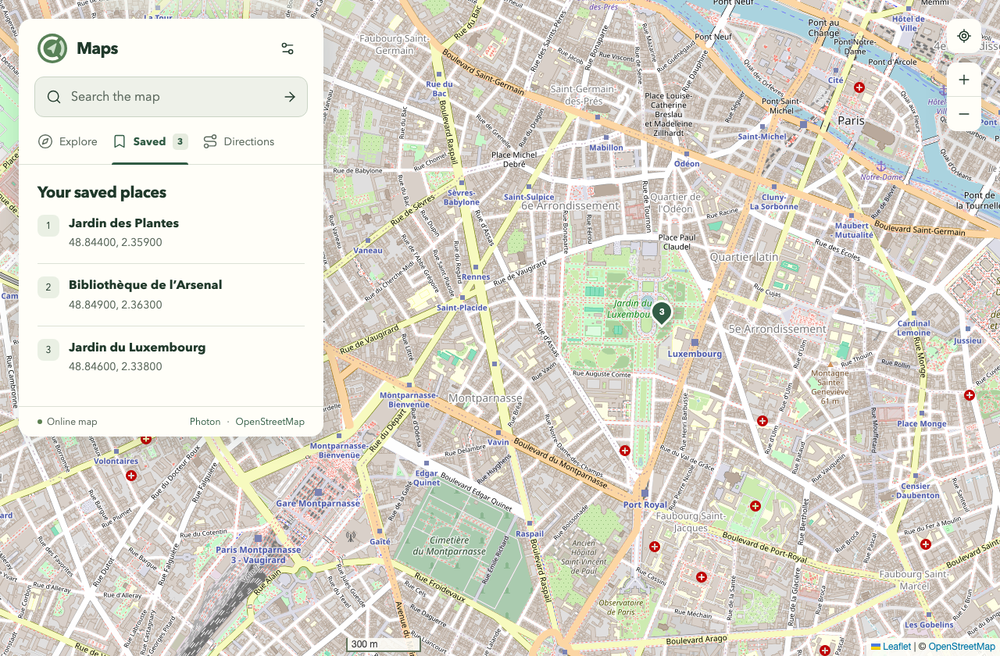
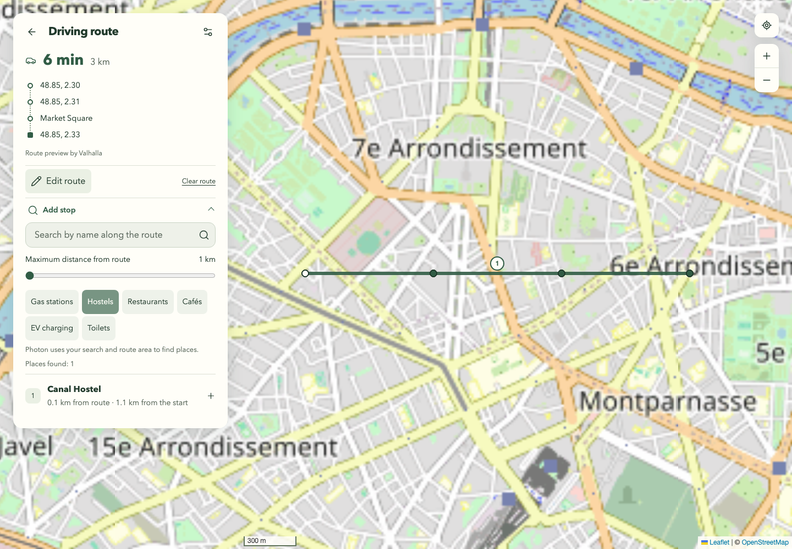
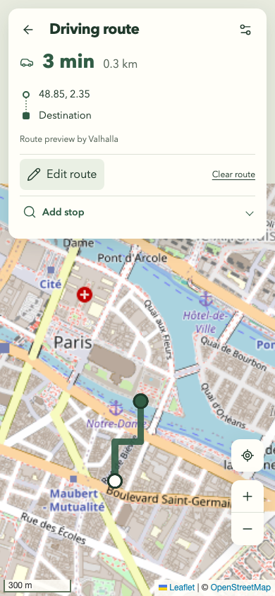

# Maps

Download an area on Android to search its streets, follow a route and save places without a connection. In a browser, you can look up an address with Photon, save a place or preview a drive with several stops.

Maps began as a fork of [CoMaps](https://codeberg.org/comaps/comaps), which grew out of Organic Maps and MAPS.ME. This project maintains a bilingual web companion, Photon search alongside the Android offline index, and an OsmAnd favorites importer that checks for duplicates.

[Open Maps in your browser](https://maps.camille.studio) · [Download the Android app](https://download.camille.studio)

## Places and directions

On Android, use the layers panel to choose which saved places appear on the map. The web app keeps saved places in the browser. Its driving planner can avoid tolls and motorways and find places near a route. Online route previews use Valhalla after you allow the app to send the route coordinates.

*Open Saved to find places you have bookmarked in this browser.*

*Pick a place along a route to add it as a stop.*

*Preview a drive before opening the native app for navigation.*

See the [web guide](web/README.md) for hosting and data-service details. The [build guide](docs/INSTALL.md) covers the native application.

## Credits and licenses

The native code uses the [Apache License 2.0](LICENSE). See [NOTICE](NOTICE) and the [component credits](data/copyright.html) for the original authors, libraries and artwork. Map data comes from [OpenStreetMap contributors](https://www.openstreetmap.org/copyright) under the Open Database License.
