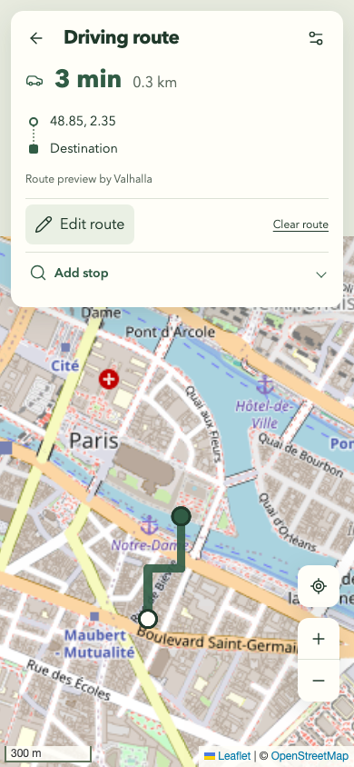

# Maps for the web

Search for an address, save a meeting point or plan a drive with several stops. [Self-host the web map](#hosting) · [Maps for Android](../README.md)

## Find a place and plan a route

Submit a name or address to search with Photon. Select a result to save it in this browser or share its coordinates. For a drive, choose a starting point and destination. The route planner asks before sending your stops to Valhalla. You can avoid tolls or motorways, or search near the route for a place to stop.

<a href="../docs/screenshots/directions.png"></a>

*Preview the trip in the browser and open Maps on Android for turn-by-turn navigation.*

The app opens offline after installation and keeps saved places on this device. Download regions in the Android app for offline search and navigation. English and French follow the browser language, or you can choose a language in Settings.

## Development

Node.js 22.12 or newer is required.

```sh
npm ci
npm run dev
npm run build
npm test
```

Production output is `dist/`. The build generates a content-versioned service worker that precaches local assets only. External tiles use ordinary HTTP caching; there is no tile prefetch, bulk download, or persistent offline tile cache. Service worker updates activate after existing app windows close.

## Hosting

Serve the contents of `dist/` at the root of your own HTTPS site. Configure your static host to revalidate HTML, the manifest and `sw.js` on each visit. Hashed assets can use immutable caching. Return HTTP 404 for missing assets. Keep using the same origin so installed browsers retain their saved places.

## Data services and credits

- Map data and tiles: [OpenStreetMap contributors](https://www.openstreetmap.org/copyright), under the [tile usage policy](https://operations.osmfoundation.org/policies/tiles/).
- Geocoding: [Photon](https://github.com/komoot/photon), using the public Komoot demo for moderate personal use. Search is submitted explicitly rather than on every keystroke. The public service has no availability guarantee; use a dedicated instance for heavier traffic.
- Driving route previews use Valhalla after one-time coordinate-sharing consent, with toll and motorway avoidance. The service address is configurable; the default is https://valhalla1.openstreetmap.de. Routes are previews, not navigation instructions.
- Mapping library: [Leaflet](https://leafletjs.com/), BSD-2-Clause. Icons: [Lucide](https://lucide.dev/), ISC. The CoMaps mark is reused from this repository's `docs/badges/logo.svg`.

The browser sends search text and map centre to Photon, and driving stops to Valhalla. Searching along a route sends the place name or type and bounding boxes covering the trip to Photon. The distance slider filters results from 1 to 100 km away from the route. Selecting a place inserts it on the nearest leg and recalculates the trip.

Routing evaluation and native adapter tests: [Valhalla evaluation](../tools/routing/valhalla/README.md).

The deployment CSP permits the explicitly requested `valhalla1.openstreetmap.de` demo host. It is selected by default and contacted only after consent. Add your own service origin to `connect-src` in `deploy/Caddyfile` before using it in production; keep this allowlist narrow. Route requests also require the service to allow the web origin through CORS.
